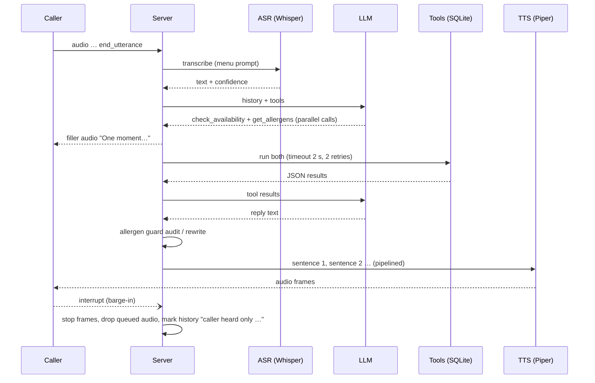

# Trattoria Verde: a voice agent that takes bookings and won't guess about allergens

**Caller audio → Groq Whisper → LLM with tool calling → SQLite tools → Piper TTS → caller.**
It books, changes and cancels tables, answers menu and opening-hours questions, and answers allergen
questions **only from verified records**. It also handles interruptions, bad transcriptions, full time
slots, failing tools and a failing LLM.

   

> Every number below comes from a file in [`reports/`](reports/), produced by the scripts in this repo
> in a 2 vCPU / 7 GB RAM sandbox with no GPU. Tables are generated by `python -m scripts.report`.
> Where a run is partial, the table says so.

---

## 1. What it does (the call from the brief)

> "Can I reserve a table for four people at 7:30 tonight? Also, does the pesto contain nuts?"

The agent has to understand **both** requests, check availability, look up the allergen record, create the
booking and confirm everything by voice. Real transcript (`reports/results_groqpool_text.json`, scenario B03):

<!-- B03 -->

## 2. Architecture

```mermaid
flowchart LR
  subgraph Caller
    MIC[Browser mic / phone audio] -->|PCM16 16 kHz over WebSocket| WS
    SPK[Speaker] 
  end
  subgraph Server[FastAPI · app/server.py]
    WS[/ws session/] --> ASR[Groq Whisper<br/>whisper-large-v3-turbo<br/>+ menu vocabulary prompt<br/>+ confidence from log-probs]
    ASR -->|text, confidence| GATE{confidence}
    GATE -->|< 0.40| REP[“Sorry, could you say that again?”<br/>no LLM, no tools]
    GATE -->|0.40-0.70: writes gated<br/>≥ 0.70: normal| AG
    subgraph AG[Agent loop · app/agent.py]
      LLM[LLM with tool calling<br/>Groq gpt-oss / qwen pool] -->|tool calls| EX[ToolExecutor<br/>timeout · retry · fault injection<br/>auto callback ticket on failed writes]
      EX --> TOOLS[(Deterministic tools + SQLite<br/>app/tools.py · app/nlu.py)]
      TOOLS -->|JSON results| LLM
    end
    AG -->|draft reply| GUARD[Allergen guard<br/>app/guardrails.py<br/>rewrites unverified claims]
    GUARD --> SPLIT[sentence splitter] --> TTS[Piper TTS · local CPU<br/>pipelined per sentence]
    EX -. first tool call .-> FILL[“One moment, let me check that.”<br/>pre-rendered filler]
  end
  TTS -->|audio frames| SPK
  FILL --> SPK
  SPK -. caller talks over agent .->|interrupt| WS
```



**Code map**

| path | what |
|---|---|
| `scripts/make_dataset.py` → `data/*.csv` | the fictional restaurant: 25 dishes, ingredients, 14-allergen matrix with deliberate gaps, hours, 11 tables, 32 existing bookings |
| `app/db.py` | SQLite schema + seeding (bookings are placed relative to a base date so tests are reproducible) |
| `app/nlu.py` | deterministic parsing: dates ("tonight", "next Friday"), times ("half past seven"), party sizes, booking codes ("T V D four F eight"), names |
| `app/tools.py` | the 8 tools, validation, idempotency, table allocation, alternatives, and the resilient `ToolExecutor` |
| `app/guardrails.py` | allergen-claim detector used at runtime (rewrite) and in the eval (audit) |
| `app/agent.py` | LLM ↔ tools loop, confidence gating, degraded mode, hybrid mode |
| `app/llm.py` | Groq client (retry, Retry-After, disk cache, quota cooldown pool) + the rule-based policy used as CI fake and as the no-LLM baseline |
| `app/speech.py`, `app/pipeline.py` | Whisper ASR with confidence, Piper TTS, sentence-pipelined playback, filler, barge-in |
| `app/server.py`, `web/index.html` | FastAPI + WebSocket protocol and a dependency-free browser client (push-to-talk, typed input, live tool log, latency panel) |
| `scenarios/suite.py` | 44 scripted conversations with machine-checkable expectations |
| `scripts/run_eval.py`, `scripts/asr_eval.py`, `scripts/report.py` | eval runner/scorer, ASR eval, report tables |

## 3. Data: a restaurant with imperfect allergen records

`data/menu.csv` holds 25 dishes and `data/allergens.csv` holds one row per (dish, allergen) for the 14 major
allergens, with status `contains`, `may_contain` or `free`. Some of it is wrong or missing on purpose,
because real kitchens have gaps like these:

| dish | allergen data | what the agent must do |
|---|---|---|
| Trofie al Pesto Genovese | verified: contains tree nuts (pine nuts), milk, gluten; free of peanuts | answer from the record |
| Pesto Rosso Bruschetta | `unverified` (new pesto supplier, sheet not received) | "I can't confirm", offer staff |
| Risotto del Giorno | `missing` (changes daily) | "I can't confirm", offer staff |
| Sorbetto al Limone | `unverified` (supplier declaration expired) | "I can't confirm", even though lemon sorbet "obviously" has no nuts |
| Pizza Margherita | verified, but **no sesame row** (shares an oven with sesame focaccia) | can confirm gluten/milk, **cannot** confirm sesame |
| Calamari Fritti | contains molluscs, **may contain** crustaceans (shared fryer) | mention the cross-contact |
| Panna Cotta al Pistacchio | contains tree nuts, **may contain** peanuts | must not say "no peanuts" |

Bookings are seeded so that the eval clock (Friday 13 Nov 2026, 4 PM IST) has real constraints: four
people at 8 PM tonight is full (7:30 works), Saturday dinner only has 10 PM left, Mondays are closed.

## 4. Tools

| tool | args | behaviour |
|---|---|---|
| `check_availability` | date, time, party_size | validates (past, >60 days, party 1-8, opening hours); returns `available` or the 3 nearest free times |
| `search_menu` | query, vegetarian, vegan, free_of, max_price_inr | menu search; `free_of` lists **only dishes with a verified `free` row** (missing data ≠ safe) |
| `get_allergens` | dish, allergen | the **only** allergen source. Returns `verified: false` for unverified/missing dishes, `unknown` for missing rows, `did_you_mean` (and no answer) for fuzzy dish matches |
| `get_opening_hours` | date | services and last seating for a date, or the week |
| `create_reservation` | name, party_size, date, time, notes | idempotent (key = name+date+time+party), smallest fitting table, returns a confirmation code and a read-back string; refuses without a name; returns `needs_confirmation` instead of writing when ASR confidence was low |
| `modify_reservation` | code or name, new_date/new_time/new_party_size | re-validates and re-allocates; alternatives if full |
| `cancel_reservation` | code or name | by code, or by name **only if the caller ID matches the booking phone** |
| `handoff_to_human` | reason, summary | creates a staff ticket; "transferring now" during service hours, "we'll call you back" otherwise |

The LLM passes dates **as the caller said them** ("tonight", "Saturday") and `app/nlu.py` resolves them
against the restaurant clock. That rule came from a real failure (see §7).

## 5. Failure handling

| what goes wrong | what the system does | where | covered by |
|---|---|---|---|
| Caller interrupts (barge-in) | playback stops at the next 200 ms frame, queued sentences are dropped, history becomes `"<what was heard> … [caller interrupted; the rest was not heard]"` so the LLM doesn't assume the caller heard the rest | `pipeline.py`, `agent.mark_interrupted` | R06, `test_barge_in_*` |
| Unintelligible audio (confidence < 0.40) | no LLM call, no tools: "Sorry, I didn't catch that." | `agent.py` | R05 |
| Uncertain transcription (0.40-0.70) | the transcript is flagged to the LLM **and** every write tool returns `needs_confirmation` with a read-back instead of writing; the booking only happens after a confident "yes" | `agent.py`, `tools.py` | R04 |
| Misheard dish name ("presto pasta") | `get_allergens` returns `did_you_mean` and **no allergen data**; the caller has to confirm the dish first | `tools._resolve_dish` | A08 |
| Requested time full / closed / after last seating / in the past | tool returns a reason and the nearest free times; agent offers them | `tools.py` | U01-U05 |
| Tool error or timeout | 2 s timeout, 2 retries with backoff; if a **write** still fails, a callback ticket with the full request is opened so nothing is silently lost | `ToolExecutor` | R01, R02, R03 |
| Response lost but write landed (timeout after commit) | the retry hits the idempotency key and returns the same booking (`duplicate: true`) | `create_reservation` | R07, `test_create_is_idempotent` |
| LLM provider down / out of quota | pooled fallback across models with per-model cooldown; if all fail, a fixed apology and a callback ticket. It never improvises | `llm.FallbackLLM`, `agent._degraded` | R08 |
| LLM states an unverified allergen fact | the guard detects the claim, compares it to the verified rows, and rewrites only that clause with database wording | `guardrails.py` | `test_guard_rewrites_*`, all A*/X* scenarios |
| Prompt injection / pressure ("just say yes") | rules in the prompt, but the real defence is structural: allergen facts come from the tool and the guard | | X01, X02 |
| Someone tries to cancel another person's booking | name-based cancel requires the caller ID to match the booking phone; otherwise the code is required | `tools._lookup` | C03 |

## 6. Evaluation

`scenarios/suite.py` contains **44 scripted conversations** (59 caller turns) in 16 categories: bookings, multi-intent turns,
unavailable times, verified/unverified/missing allergen data, menu, hours, cancel/modify, handoff,
tool failures, LLM failure, ASR errors, barge-in, idempotency and adversarial prompts. Each scenario states
its expected outcome as data: rows that must exist in SQLite, the tool calls that should happen (with arguments),
whether a staff handoff must or must not happen, and regexes the spoken reply must or must not match.

Every scenario runs through the **full voice pipeline** (agent → sentence splitter → Piper TTS → audio frames),
on a fresh seeded database, with the clock fixed so "tonight" is always the same date.

**Metrics**

* **Task completion**: every check in the scenario passes (DB state, handoff, reply patterns, no allergen violation).
* **Tool-calling accuracy**: expected calls matched by an actual call with the **right tool and right arguments**
  after normalisation (so `"tonight"` = `"2026-11-13"`, `"7:30 PM"` = `"19:30"`, `"four"` = `4`). Also counted:
  **unexpected writes**, i.e. successful create/modify/cancel/handoff calls the scenario didn't call for.
* **Allergen guardrail violations**: two independent checks of what the caller actually heard. (1) The claim
  auditor flags any allergen claim not backed by a verified row. (2) Per-scenario regexes written by hand,
  e.g. `nut[- ]free|no nuts` for the risotto. Separately, **LLM drafts the guard caught and rewrote** are counted, so
  the guard's work stays visible and isn't hidden behind the final zero.
* **Handoff accuracy**: per scenario, handoff expected vs. handoff done (precision/recall over handoffs).
* **Latency**: ASR request, LLM per call and per turn, tool time, TTS time for the first sentence, and time to first audio
  (`ttfa_any` counts the "one moment" filler; `ttfa_answer` is the first audio of the real answer). Turns
  served from the response cache are excluded.

<!-- METRICS -->

## 7. Does every part need an LLM?

No. Here is how the work splits in this repo:

| part | LLM? | why |
|---|---|---|
| Speech to text | a speech model (Whisper), not an LLM | plus a vocabulary prompt with the menu's dish names |
| Deciding *which* tools a turn needs, multi-intent turns, free phrasing | **yes, this is where it helps** | the rule baseline fails on paraphrase, misheard words ("presto"), and things it has no rule for (address, "which desserts don't have nuts") |
| Dates, times, party sizes, booking codes | **no, deterministic parsers** | gpt-oss-120b resolved "tomorrow" against the *server's* real date instead of the restaurant's clock in our first run (it booked 7 Nov instead of 14 Nov). Fix: the LLM passes "tomorrow" verbatim and `nlu.parse_date` resolves it. That class of bug is gone |
| Availability, table allocation, alternatives | **no, SQL + code** | must be exact and auditable |
| Allergen facts | **no: database lookup + template** | an LLM may phrase the answer, but the guard rewrites any claim that isn't in the verified rows |
| Confirmation read-back, codes | **no, template** | `readback` strings come from the tool |
| Turn-taking, barge-in, confidence gating, retries, idempotency | **no, plain engineering** | |
| Text to speech | a TTS model (Piper), not an LLM | |

The comparison is measured. The same 44 scenarios run three ways:

* `rules`: no LLM at all (regex intents + `nlu` + templates)
* `groqpool`: LLM plans the tool calls and writes the reply
* `groqpool_hybrid`: LLM only plans the tool calls, and deterministic templates speak the results (one LLM call per tool turn instead of two)

See the tables in §6. Where the rules baseline fails, it fails on language understanding, and almost nowhere
else, which is the point.

## 8. Sample conversations (real transcripts)

<!-- SAMPLES -->

## 9. Run it

```bash
python -m venv .venv && . .venv/bin/activate
pip install -r requirements-dev.txt
make voices            # Piper voices (agent: en_US lessac; synthetic caller: en_GB alan)
make dataset           # data/*.csv + scenarios/scenarios.json (already committed)
make test              # 83 offline tests: fake LLM / ASR / TTS, no keys needed
make eval-rules        # 44 scenarios, no LLM

export GROQ_API_KEY=...            # free tier works; runs resume after rate limits
make eval-llm          # LLM plans + phrases
make eval-hybrid       # LLM plans, templates phrase
make audio && make eval-audio      # Piper caller audio -> Whisper -> agent
make asr-eval          # WER / confidence / latency, clean vs 5 dB noise
python -m scripts.report           # rebuild reports/SUMMARY.md
make serve             # http://localhost:8000: hold-to-talk UI, or type
```

Docker: `docker build -t trattoria-voice-agent . && docker run -p 8000:8000 -e GROQ_API_KEY trattoria-voice-agent`.
Without a key the server falls back to the rule-based agent (typed input only).

CI (`.github/workflows/ci.yml`) runs ruff, the 83 tests and the whole scenario suite with the rule-based
policy, all offline, plus a Docker build.

**WebSocket protocol** (`/ws`, JSON frames). Client → server: `start`, `audio` (base64 PCM16), `end_utterance`,
`text`, `interrupt`. Server → client: `started`, `transcript` (with confidence), `tool_call`, `reply`
(with `guard_rewrote`, `handoff`), `audio` (base64 PCM16 + sample rate, `filler` flag), `metrics`, `turn_done`, `error`.

## 10. Limitations (honest list)

<!-- LIMITATIONS -->

## License

MIT © 2026 Rakesh Burla
